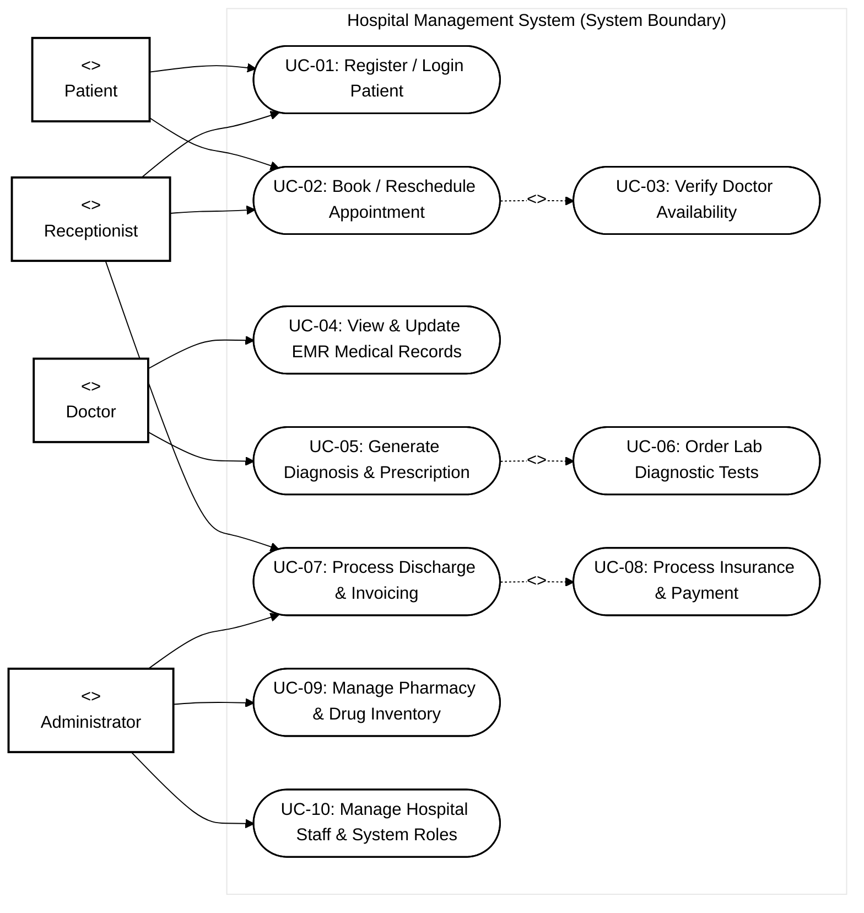
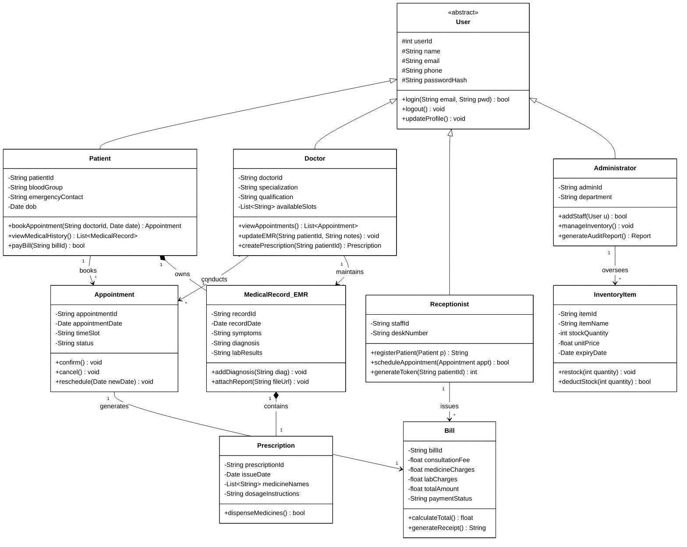
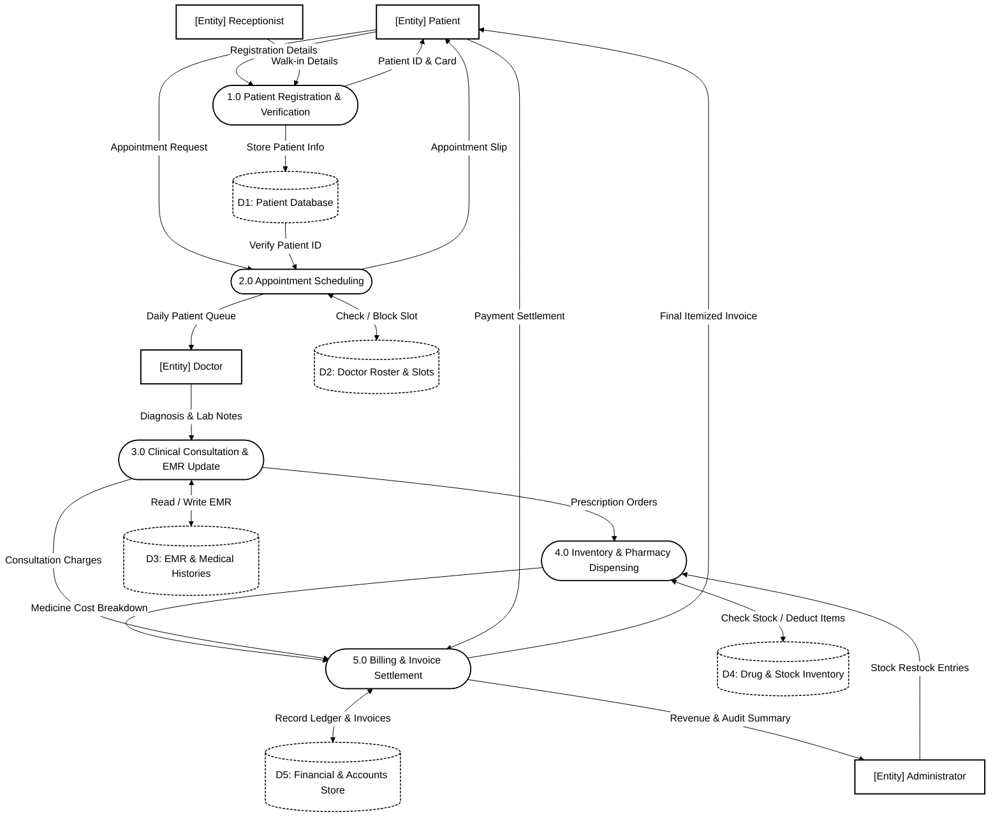
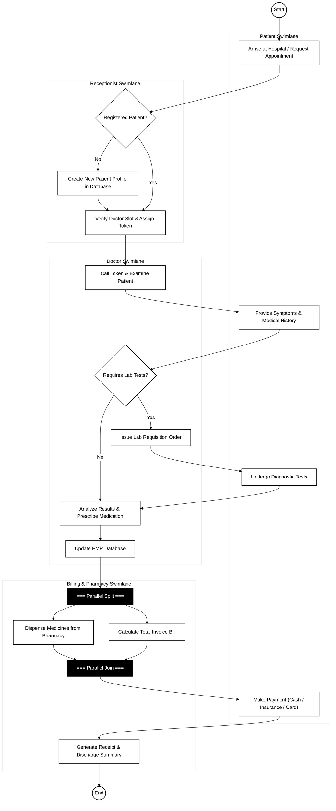

# Hospital Management System - Software Engineering (SE) Specification

## 1. Case Study Overview
The Hospital Management System manages hospital operations ranging from patient registration and appointment scheduling to billing, pharmacy inventory, and Electronic Medical Records (EMR). It serves four primary stakeholder modules: **Patient**, **Receptionist**, **Doctor**, and **Administrator**.

---

## 2. Use Case Diagram (Black & White UML Standard)

---

## 3. Class Diagram (UML Structure)

---

## 4. Data Flow Diagram (Level 1 DFD)

---

## 5. Activity Diagram (Workflow with Swimlanes)

