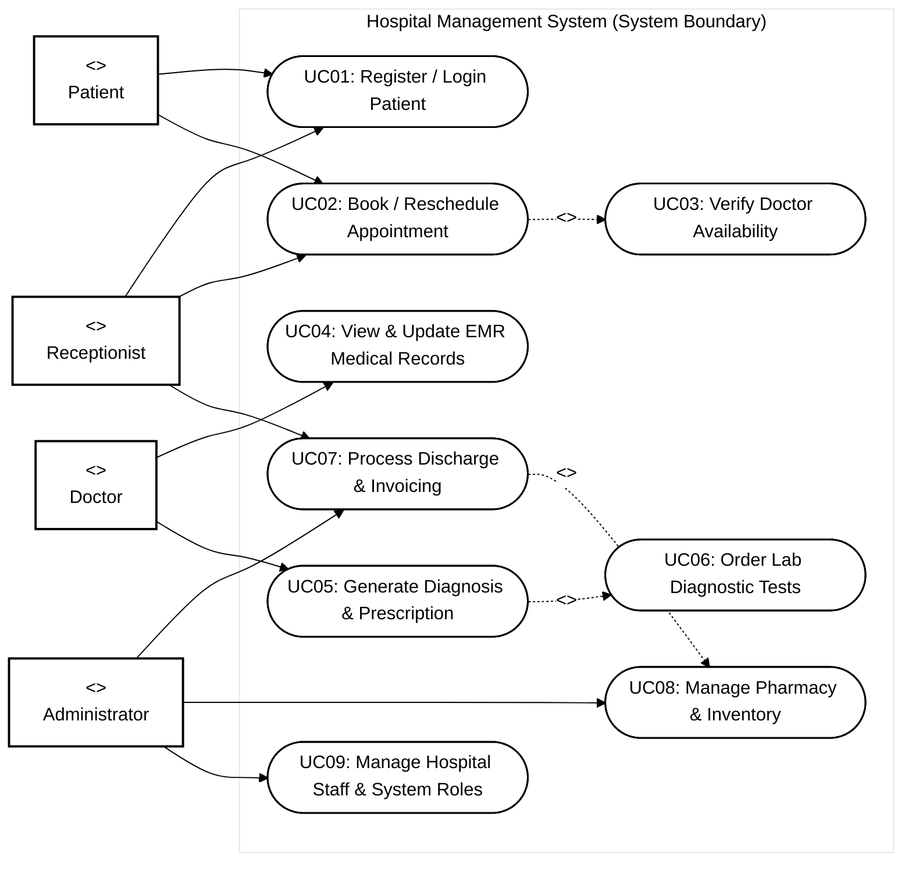
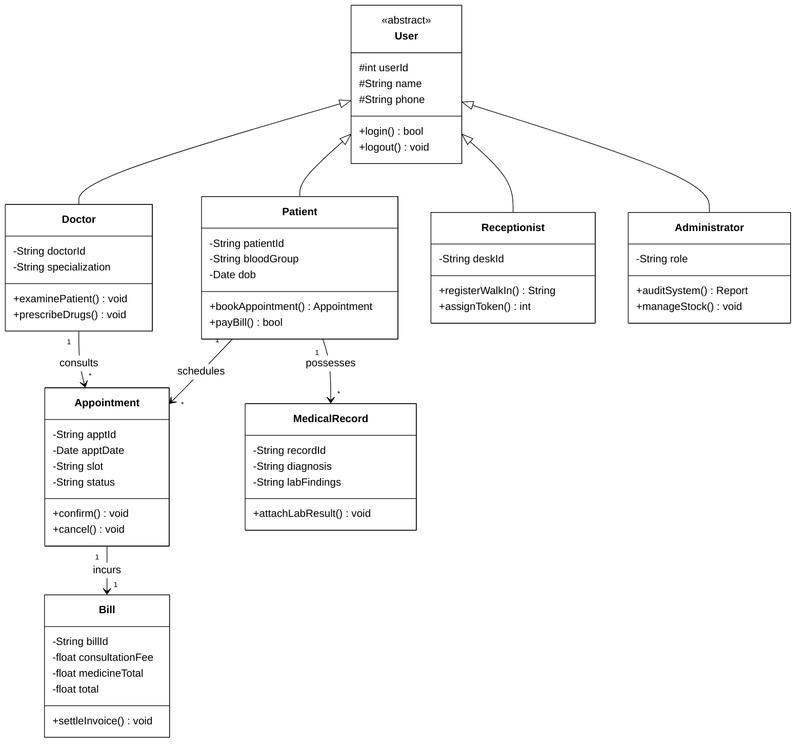
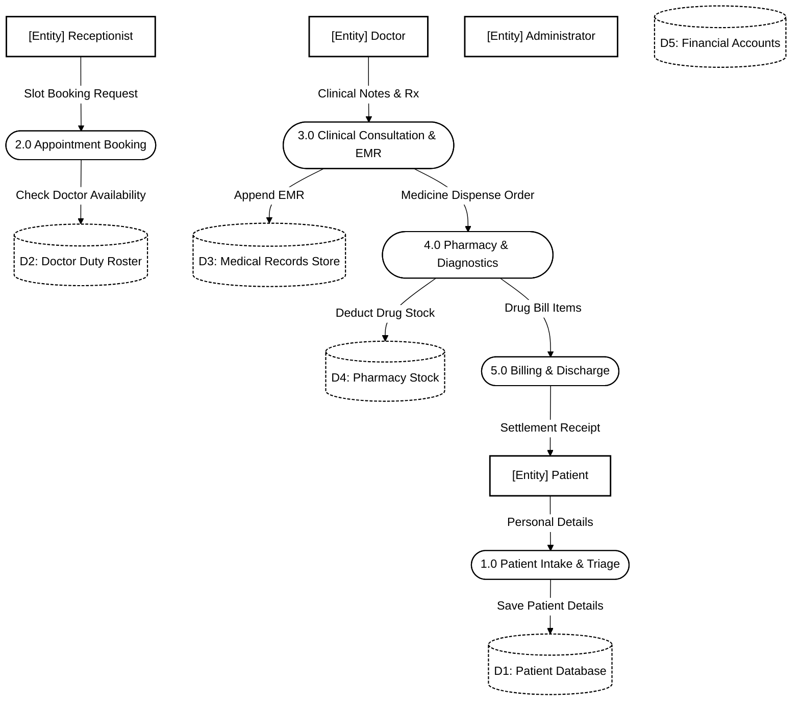
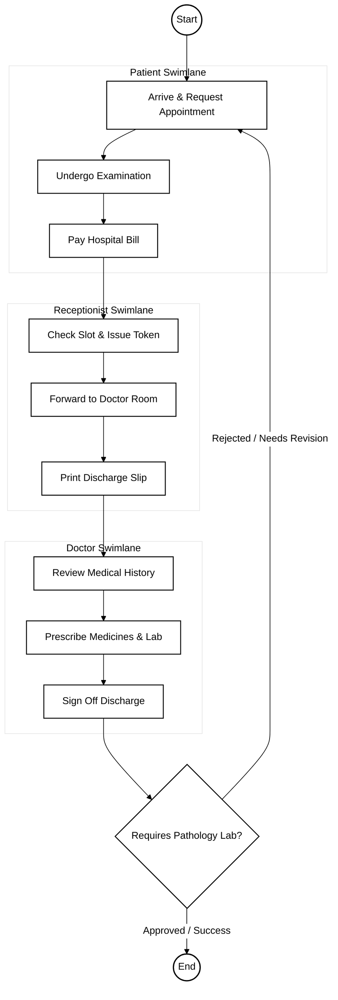

# Hospital Management System - Software Engineering (SE) Specification

## 1. Case Study Overview
Manages doctor schedules, outpatient/inpatient admissions, Electronic Medical Records (EMR), laboratory diagnostics, pharmacy inventory, and billing settlement.

---

## 2. Use Case Diagram (Black & White UML Standard)

---

## 3. Class Diagram (UML Structure)

---

## 4. Data Flow Diagram (Level 1 DFD)

---

## 5. Activity Diagram (Workflow with Swimlanes)

