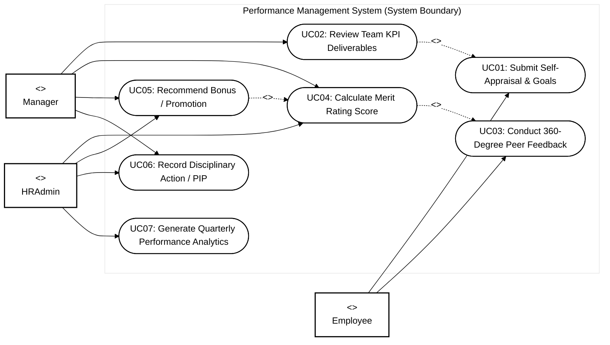
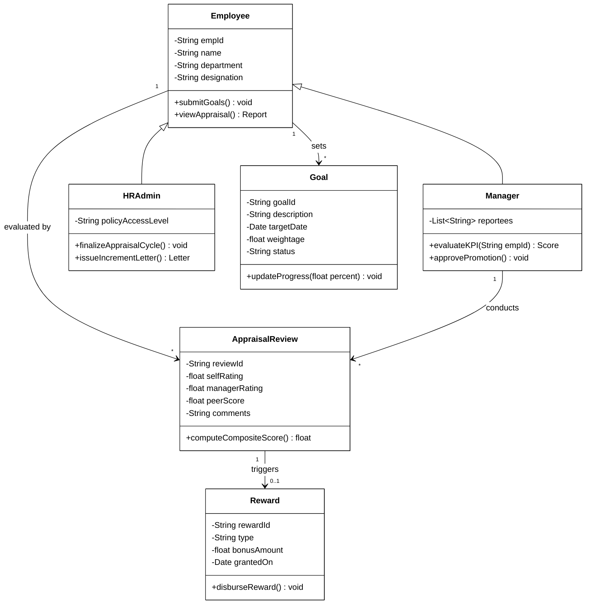
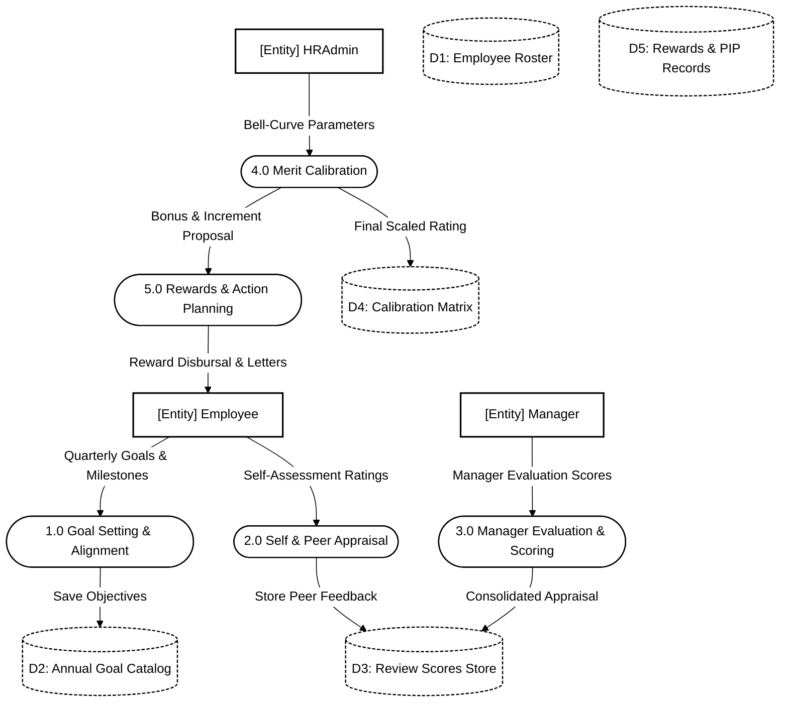
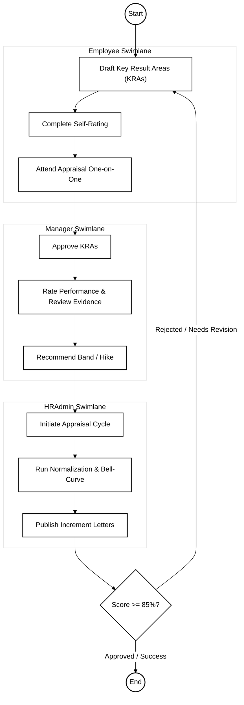

# Performance Management System - Software Engineering (SE) Specification

## 1. Case Study Overview
Holds employee performance appraisals, reviews, milestone ratings, KPIs, 360-degree feedback, reward allocations, and disciplinary tracking.

---

## 2. Use Case Diagram (Black & White UML Standard)

---

## 3. Class Diagram (UML Structure)

---

## 4. Data Flow Diagram (Level 1 DFD)

---

## 5. Activity Diagram (Workflow with Swimlanes)

