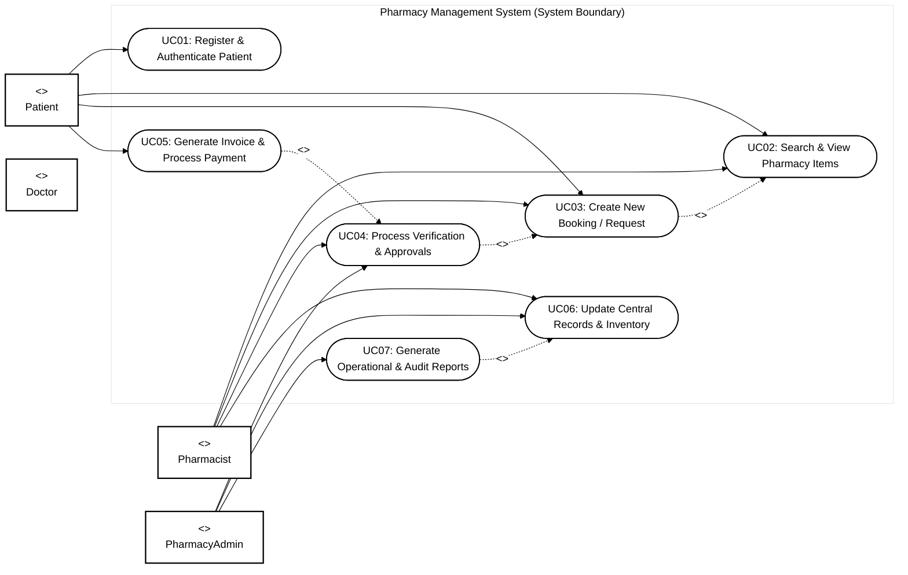
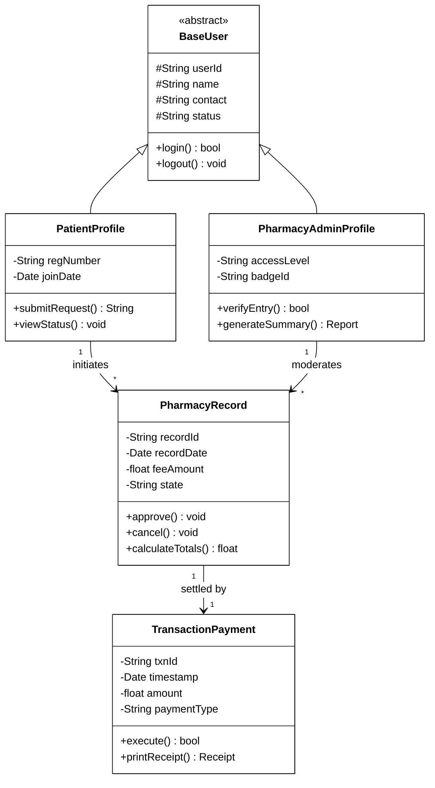
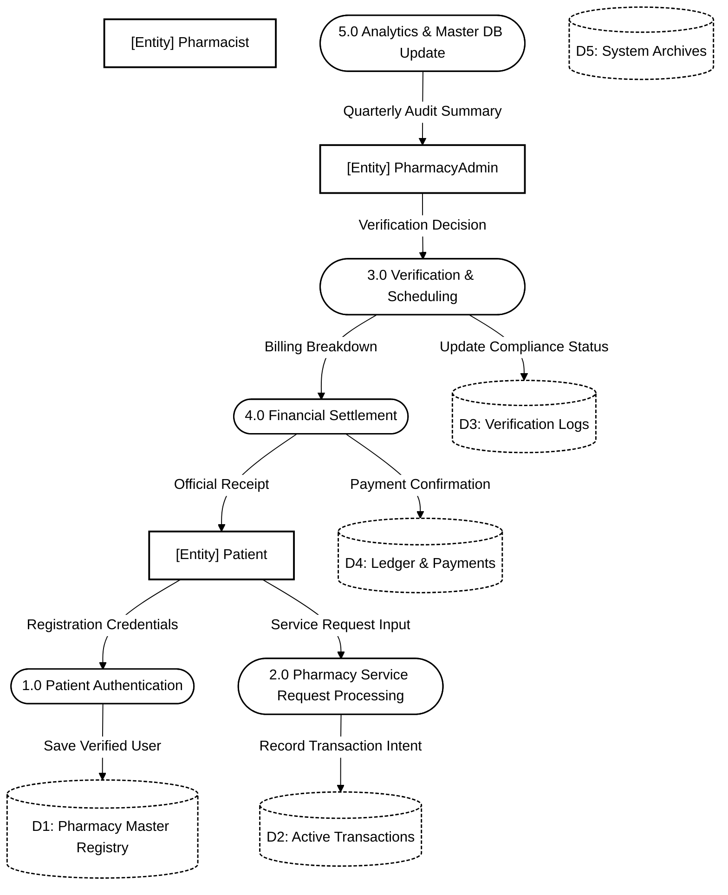
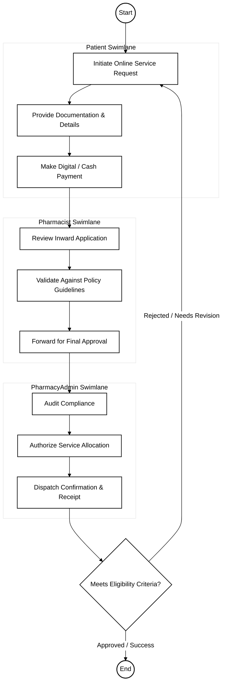

# Pharmacy Management System - Software Engineering (SE) Specification

## 1. Case Study Overview
Manages prescription validation, drug stock inventory, supplier batch expiries, POS cash counter billing, and regulatory drug audits.

---

## 2. Use Case Diagram (Black & White UML Standard)

---

## 3. Class Diagram (UML Structure)

---

## 4. Data Flow Diagram (Level 1 DFD)

---

## 5. Activity Diagram (Workflow with Swimlanes)

