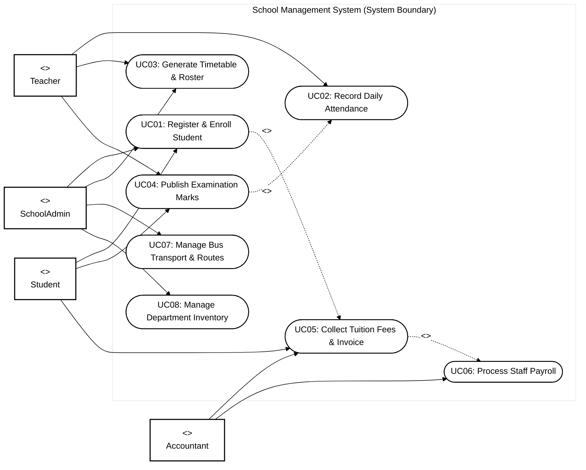
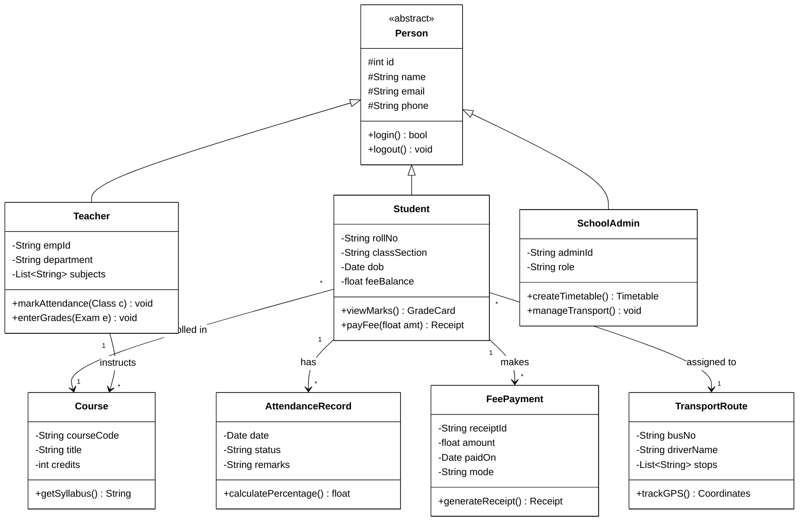
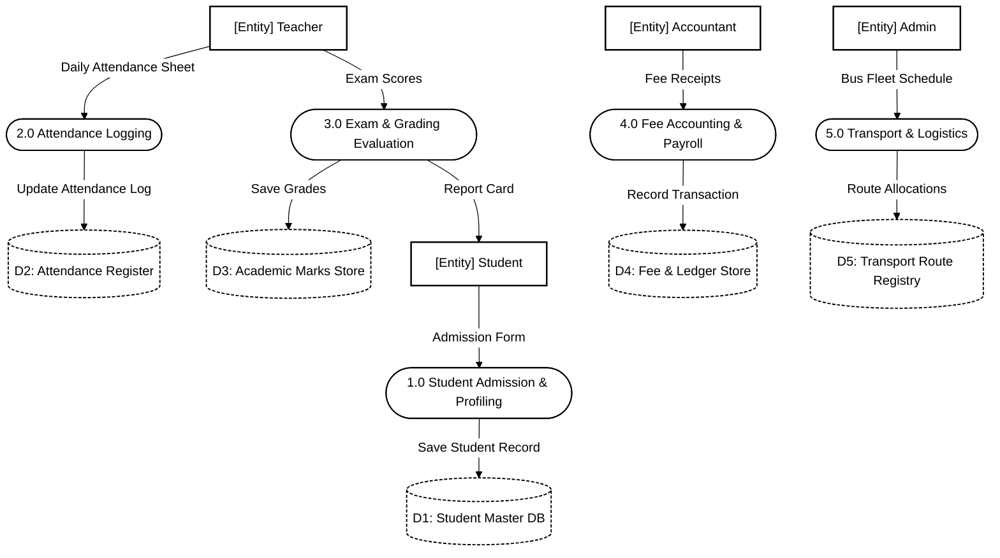
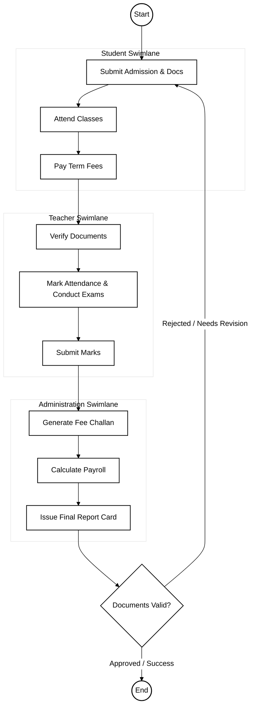

# School Management System - Software Engineering (SE) Specification

## 1. Case Study Overview
Manages academic operations: student profiles, admissions, attendance tracking, fee collection, exam schedules, grading, staff payroll, timetables, and transport inventory.

---

## 2. Use Case Diagram (Black & White UML Standard)

---

## 3. Class Diagram (UML Structure)

---

## 4. Data Flow Diagram (Level 1 DFD)

---

## 5. Activity Diagram (Workflow with Swimlanes)

