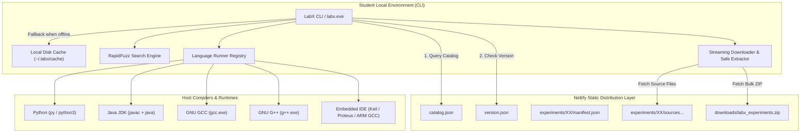
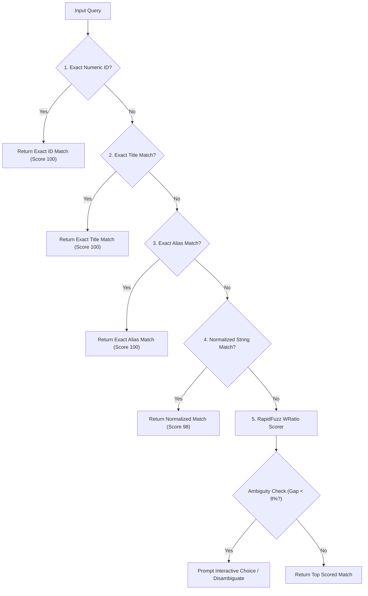
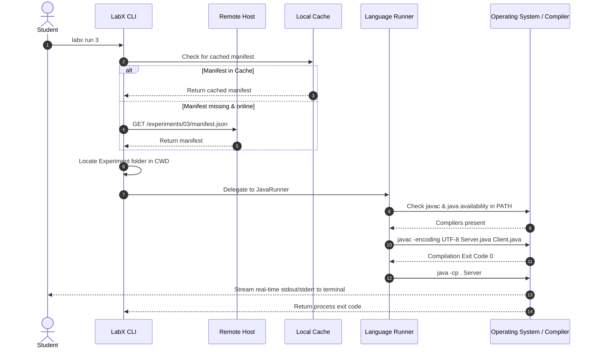

# LabX Remote Architecture & Design Specification

This document details the architectural design, security model, and component interactions of **LabX Remote**.

---

## 1. High-Level Architecture

LabX Remote employs a two-tier decoupled client-server architecture:

---

## 2. Remote Hosting Layer (Netlify)

The remote layer is hosted as a serverless static repository on Netlify.
It serves as an API backend without requiring a relational database or stateful server:

- **Predictable URL Scheme**:
  - `GET /catalog.json` - High-level catalog containing metadata for all experiments.
  - `GET /version.json` - System version and backend heartbeat.
  - `GET /experiments/{id}/manifest.json` - Detailed metadata, algorithm, aim, theory, and source file list.
  - `GET /experiments/{id}/{filename}` - Individual source and header files.
  - `GET /downloads/labx_experiments.zip` - Complete pre-packaged experiment archive.
- **CORS & Cache Controls**: Configured via `netlify.toml` with `Access-Control-Allow-Origin: *` to allow access from any client.

---

## 3. Fuzzy Matching & Resolution Engine

When a student types `labx download <query>`, LabX resolves the input through a 5-tier matching priority:

---

## 4. Execution Workflow

---

## 5. Security Architecture

1. **Path Traversal (Zip-Slip) Protection**:
   - `is_safe_path(base_dir, target_path)` validates that every extracted file resolves strictly within the target working directory.
   - Archive entries with `../` or absolute drive roots (`C:\Windows\...`) are discarded before extraction.
2. **Subprocess Isolation**:
   - Compilers and scripts are invoked using argument arrays (e.g. `["gcc", "-Wall", "main.c"]`) rather than shell string interpolation (`shell=True`), preventing command injection.
3. **Stream Safety & Headless Compatibility**:
   - File descriptors are validated (`fileno()`) before subprocess attachment, preventing pipe crashes in automated or pseudo-terminal environments.
4. **Non-Destructive Overwrites**:
   - User files in the working directory are protected with interactive overwrite confirmations unless `--force` is explicitly provided.

